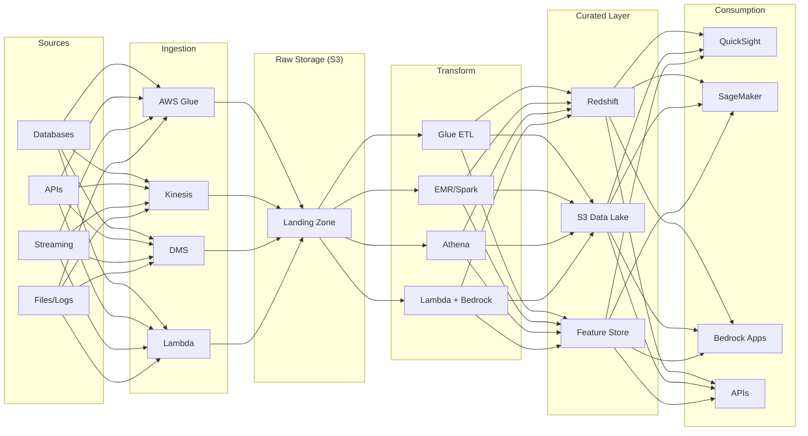
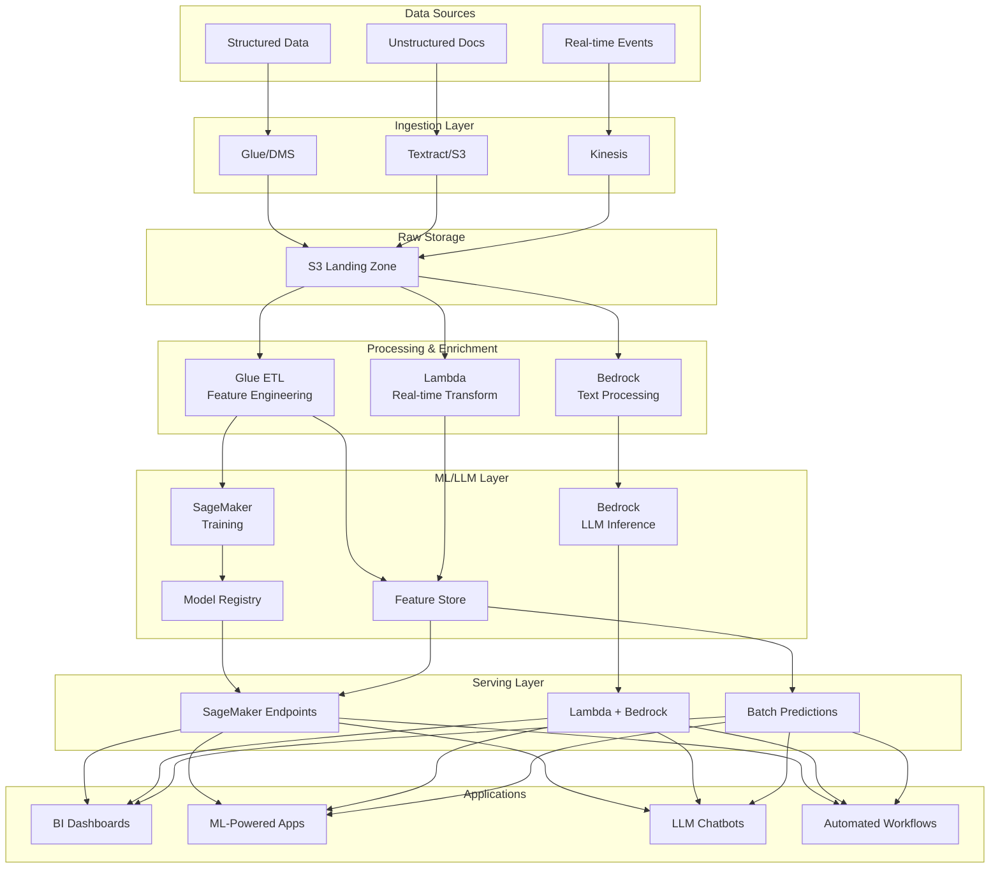
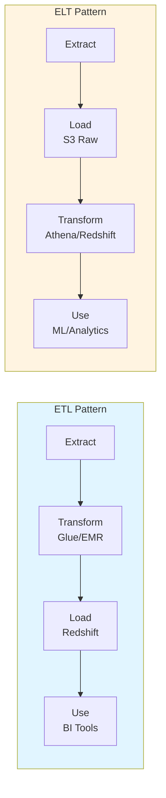
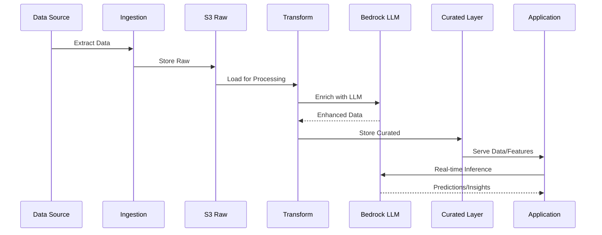
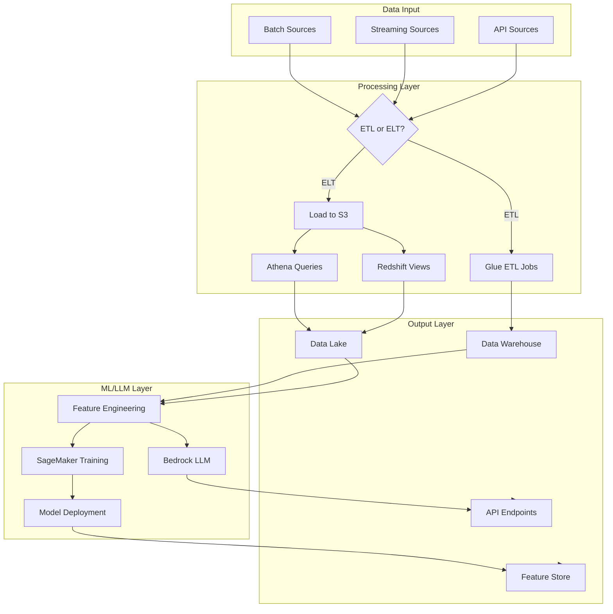
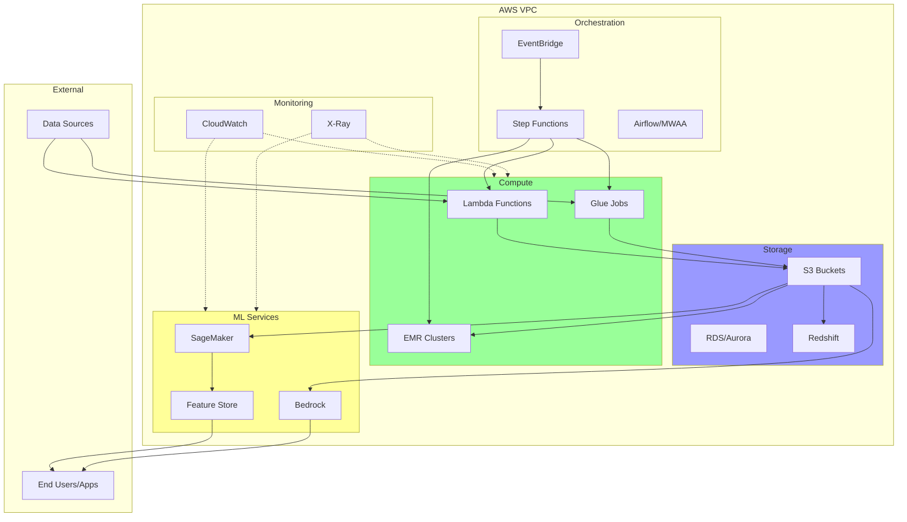

# ETL/ELT Architecture Diagrams

## High-Level Architecture

## ML/LLM Pipeline

## ETL vs ELT Pattern

## Data Flow with LLM Integration

## Component Interaction

## AWS Service Architecture

